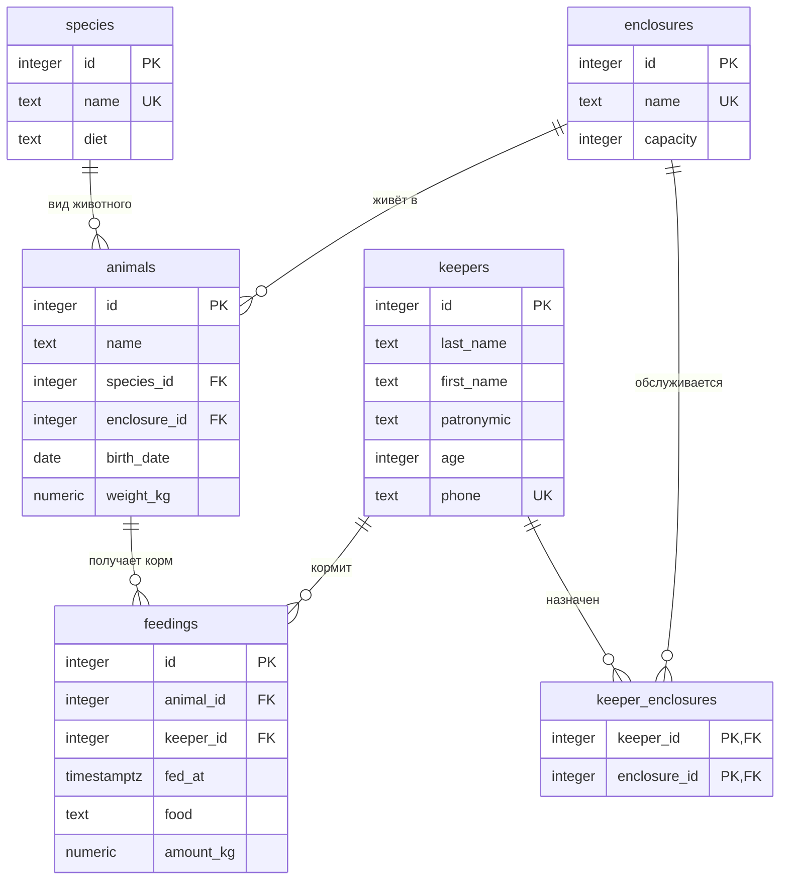

# Зоопарк "Восток - дело дальнее"

Тема № 11: **Зоопарк**. База хранит данные о животных Приморского края, их видах, вольерах, смотрителях и кормлениях, нужна сотрудникам зоопарка для учёта и ухода за животными.

| | |
| --- | --- |
| Главная таблица | `feedings` (кормления) |
| Связь N:M | смотрители и вольеры через `keeper_enclosures` |
| Бизнес-правило | хищника нельзя поселить в один вольер с травоядными |
| СУБД | PostgreSQL 17 в Docker |

## Задания курса

Правила курса, установка и порядок сдачи: [docs/README.md](docs/README.md).

| Лаба | Задание |
| --- | --- |
| 1. Модель данных и схема | [docs/lab-1.md](docs/lab-1.md) |
| 2. Запросы | [docs/lab-2.md](docs/lab-2.md) |
| 3. Логика в базе | [docs/lab-3.md](docs/lab-3.md) |
| 4. Транзакции и доступ | [docs/lab-4.md](docs/lab-4.md) |
| 5. Производительность | [docs/lab-5.md](docs/lab-5.md) |
| Витрина к защите | [docs/showcase.md](docs/showcase.md) |

## Как запустить

```bash
cp .env.example .env          # пароли и порт
docker compose up -d          # при первом запуске выполняются скрипты из db/
dbcheck run demo/lab1.sql     # сценарий лабы 1
```

Работа с базой: `docker compose exec db psql -U postgres -d app`. Сценарии выполняются в `psql` командой `\i /demo/lab1.sql`.

После изменения скриптов в `db/` базу нужно пересоздать: `docker compose down -v && docker compose up -d`.

## ER-диаграмма



## Ограничения

| Ограничение | Таблица и колонки | Зачем |
| --- | --- | --- |
| `UNIQUE` | `species (name)` | не бывает двух видов с одним названием |
| `UNIQUE` | `enclosures (name)` | у вольеров не повторяются названия |
| `UNIQUE` | `keepers (phone)` | у двух смотрителей не может быть один телефон |
| `CHECK` | `enclosures (capacity)` | вместимость вольера больше нуля |
| `CHECK` | `animals (weight_kg)` | вес животного больше нуля |
| `CHECK` | `feedings (amount_kg)` | количество корма больше нуля |
| `CHECK` | `keepers (age)` | возраст смотрителя от 18 до 90 лет |
| `CHECK` | `keepers (phone)` | телефон в формате `+7` и десять цифр |

## Что сделано по лабам

| Лаба | Что сделано | Сценарий |
| --- | --- | --- |
| 1 | ER-диаграмма (6 таблиц, связь N:M смотрители и вольеры), схема с ключами и ограничениями, тестовые данные, три отклонённые базой вставки | `demo/lab1.sql` |
| 2 | ... | `demo/lab2.sql` |
| 3 | ... | `demo/lab3.sql` |
| 4 | ... | `demo/lab4.sql`, `demo/race.sql`, `demo/race_fixed.sql` |
| 5 | ... | `demo/lab5.sql` |

## Нормализация

Исходная таблица, в которой всё хранится в одном месте (одна строка = одно кормление):

| животное | вид | питание | вольер | вместимость | смотрители вольера | время | корм | кг |
| --- | --- | --- | --- | --- | --- | --- | --- | --- |
| Амурчик | Амурский тигр | predator | Вольер амурских тигров | 4 | Есенин, Ахматова | 14.10 09:00 | Говядина | 6.00 |
| Амурчик | Амурский тигр | predator | Вольер амурских тигров | 4 | Есенин, Ахматова | 15.10 09:00 | Говядина | 6.00 |
| Полосочка | Амурский тигр | predator | Вольер амурских тигров | 4 | Есенин, Ахматова | 14.10 09:30 | Говядина | 5.00 |

**Где повторы.** Вид «Амурский тигр» и его питание записаны в каждой строке кормления каждого тигра. Вместимость вольера и список его смотрителей тоже повторяются в каждой строке. Если вольер станет вмещать 5 животных или сменится смотритель, придётся править много строк, и где-нибудь останется старое значение.

**Как разделено:**

- **1НФ.** В ячейке «смотрители вольера» стоял список через запятую. Смотрители вынесены в отдельную таблицу `keepers`, а связь «смотритель и вольер» (N:M) хранится в `keeper_enclosures`.
- **2НФ.** Ключ строки кормления это «животное + время». Но вид, вес и вольер зависят только от животного, то есть от части ключа. Они вынесены в таблицу `animals`, а в `feedings` остались только время, корм и количество.
- **3НФ.** В `animals` питание зависит от вида, а не от самого животного, значит, оно перенесено в `species`. Вместимость зависит от вольера, значит, она в `enclosures`.

Результат: `species`, `enclosures`, `keepers`, `animals`, `keeper_enclosures`, `feedings`. Каждый факт записан один раз.

## Что происходит при удалении

| Связь | Поведение | Причина |
| --- | --- | --- |
| `animals.species_id` → `species` | `RESTRICT` | нельзя удалить вид, пока есть животные этого вида |
| `animals.enclosure_id` → `enclosures` | `RESTRICT` | нельзя удалить вольер, пока в нём живут животные |
| `keeper_enclosures.keeper_id` → `keepers` | `CASCADE` | при удалении смотрителя его назначения на вольеры не нужны |
| `keeper_enclosures.enclosure_id` → `enclosures` | `CASCADE` | при удалении вольера назначения смотрителей исчезают вместе с ним |
| `feedings.animal_id` → `animals` | `CASCADE` | записи о кормлении не нужны без животного |
| `feedings.keeper_id` → `keepers` | `RESTRICT` | нельзя удалить смотрителя, пока остались записи о его кормлениях |